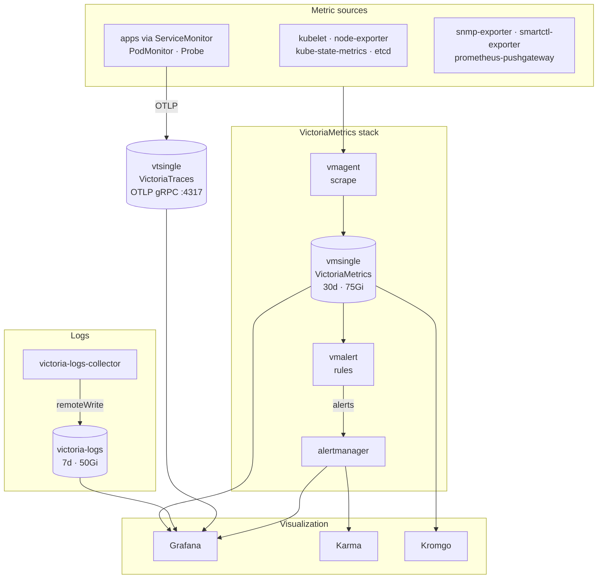

# Observability

The `observability` namespace hosts the cluster's observability stack, based on the
[VictoriaMetrics stack](https://docs.victoriametrics.com/) (metrics + logs + traces) with
**Grafana** as the visualization interface.

## Architecture

## Components

| Component                 | Role                                                                     | Endpoint                      |
| ------------------------- | ------------------------------------------------------------------------ | ----------------------------- |
| `vmagent`                 | Scrapes metrics (kubelet, node-exporter, kube-state-metrics, etcd, apps) | —                             |
| `vmsingle`                | VictoriaMetrics metric storage (30d retention)                           | `victoriametrics.hoohoot.xyz` |
| `vmalert`                 | Evaluates alerting and recording rules                                   | —                             |
| `alertmanager`            | Alert routing                                                            | `alertmanager.hoohoot.xyz`    |
| `vtsingle`                | Trace ingestion (OTLP gRPC 4317, VictoriaTraces)                         | —                             |
| `victoria-logs`           | Log storage (7d retention)                                               | `vlogs.hoohoot.xyz`           |
| `victoria-logs-collector` | Collects pod logs and ships them to VictoriaLogs                         | —                             |
| `grafana`                 | Dashboards + datasources (Prometheus, Alertmanager, VictoriaLogs, Tempo) | `grafana.hoohoot.org`         |
| `karma`                   | Alert dashboard (reads Alertmanager)                                     | `karma.hoohoot.xyz`           |
| `kromgo`                  | Cluster status badges (reads VictoriaMetrics)                            | `kromgo.hoohoot.org`          |
| `blackbox-exporter`       | External HTTP/TCP probes (`lan` and `vpn`)                               | —                             |
| `snmp-exporter`           | Network device metrics via SNMP                                          | —                             |
| `smartctl-exporter`       | Disk S.M.A.R.T. metrics                                                  | —                             |
| `prometheus-pushgateway`  | Receives pushed metrics                                                  | —                             |
| `prometheus-crds`         | Prometheus CRDs (ServiceMonitor, PodMonitor, Probe…)                     | —                             |
| `silence-operator`        | Declarative Alertmanager silences (Ceph, NFS, TrueNAS…)                  | —                             |
| `keda`                    | Event-driven autoscaling                                                 | —                             |
| `umami`                   | Web analytics                                                            | `umami.hoohoot.org`           |

## Notes

- Grafana is exposed externally (`external` gateway) and authenticated via Authentik (OIDC).
- `vmagent` uses `promscrape.streamParse` to limit memory usage when scraping the API server.
- `kube-proxy` is disabled in the scrape (Cilium replaces kube-proxy).
